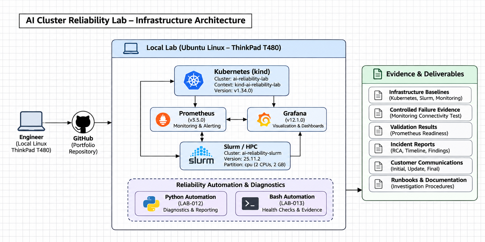
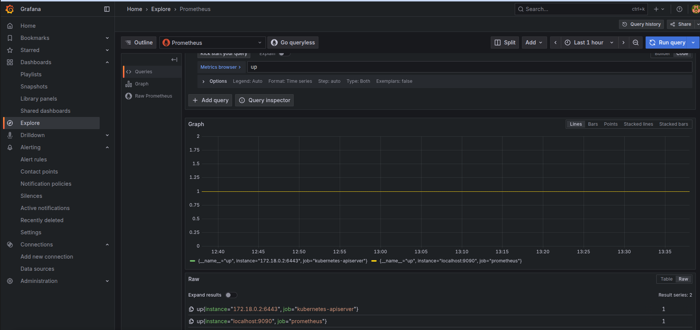
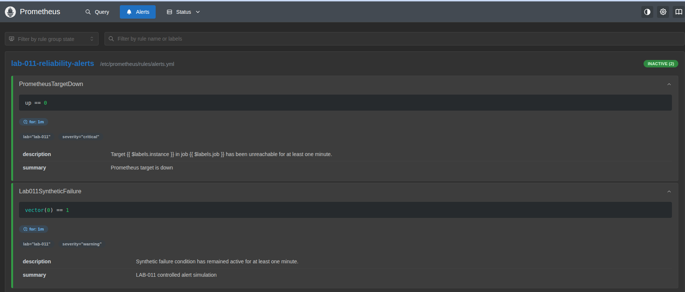

# AI Cluster Reliability Lab

**A hands-on, 15-lab engineering portfolio focused on Customer Reliability Engineering for AI Infrastructure.**

This project demonstrates practical infrastructure troubleshooting, workload scheduling, monitoring, automation, incident investigation, and customer communication using a local Linux-based lab environment.

**Project status: 15/15 labs completed | 6/6 phases completed**

## Project Overview

The AI Cluster Reliability Lab is a collection of 15 documented engineering exercises designed to develop and demonstrate skills relevant to AI Infrastructure Reliability and Customer Reliability Engineering.

The project covers:

- Kubernetes workload troubleshooting and scheduling.
- Slurm/HPC batch processing and resource management.
- Prometheus monitoring and alerting.
- Grafana metrics visualization.
- Python and Bash diagnostic automation.
- Evidence-based incident investigation and root cause analysis.
- Customer-facing incident communication.

All exercises were performed in a controlled, local training environment. GPU scheduling concepts were explored without physical NVIDIA GPU hardware.

## Infrastructure Architecture

The following diagram illustrates the main components of the local infrastructure and how they support reliability investigation, monitoring, automation, and evidence collection.



The environment consists of a Lenovo ThinkPad T480 running Ubuntu Linux, a local kind Kubernetes cluster, a Slurm/HPC scheduling environment, Prometheus and Grafana monitoring, and Python and Bash diagnostic tools.

Git and GitHub provide version control and publication of the completed lab documentation.

## Project Completion

| Category | Completed |
|---|---:|
| Kubernetes troubleshooting | 4/4 labs |
| Advanced Kubernetes scheduling | 3/3 labs |
| Slurm/HPC troubleshooting | 2/2 labs |
| Monitoring and observability | 2/2 labs |
| Reliability automation | 2/2 labs |
| Customer reliability and capstone | 2/2 labs |
| **Total** | **15/15 labs** |

**All six project phases are complete.**

## Monitoring and Observability

Prometheus and Grafana were deployed in the local kind Kubernetes cluster to provide monitoring, alerting, and metrics exploration.

### Prometheus — Alert Rules

The screenshot below shows the LAB-011 Prometheus alert rules after the controlled alerting experiment.



The two configured rules are:

- `PrometheusTargetDown` — detects unavailable monitored targets.
- `Lab011SyntheticFailure` — supports a controlled synthetic alerting test.

Both rules are shown in the **Inactive** state in the captured screenshot.

The experiment demonstrated alert-rule configuration, synthetic failure testing, investigation, and validation of the healthy rule state.

[Read LAB-011 — Alerting and Observability Troubleshooting](labs/LAB-011-alerting-and-observability-troubleshooting/README.md)

### Grafana — Metrics Exploration

Grafana was configured to use Prometheus as a metrics data source.



The screenshot shows Grafana Explore querying the Prometheus `up` metric.

The displayed Kubernetes API server and Prometheus target series both report a value of `1` during the captured interval, indicating that those monitored targets were reachable according to Prometheus.

[Read LAB-010 — Prometheus and Grafana Monitoring](labs/LAB-010-prometheus-and-grafana-monitoring/README.md)

## All 15 Labs

### Phase 1 — Kubernetes Troubleshooting

**Status: Complete — 4/4 labs**

This phase focuses on Kubernetes workload diagnosis, logs, events, resource inspection, and recovery verification.

| Lab | Documentation |
|---|---|
| LAB-001 | [View LAB-001](incidents/LAB-001/README.md) |
| LAB-002 | [View LAB-002](incidents/LAB-002/README.md) |
| LAB-003 | [View LAB-003](incidents/LAB-003/README.md) |
| LAB-004 | [View LAB-004](incidents/LAB-004/README.md) |

### Phase 2 — Advanced Kubernetes Scheduling

**Status: Complete — 3/3 labs**

This phase covers resource requests and limits, scheduling constraints, node placement, and GPU scheduling concepts explored through CPU-based simulation.

| Lab | Documentation |
|---|---|
| LAB-005 | [View LAB-005](incidents/LAB-005/README.md) |
| LAB-006 | [View LAB-006](incidents/LAB-006/README.md) |
| LAB-007 | [View LAB-007](incidents/LAB-007/README.md) |

### Phase 3 — Slurm / HPC Troubleshooting

**Status: Complete — 2/2 labs**

This phase demonstrates Slurm job scheduling, queue investigation, resource contention, application failures, and compute-daemon recovery validation.

| Lab | Focus | Documentation |
|---|---|---|
| LAB-008 | Slurm Batch Jobs and Queues | [View LAB-008](labs/LAB-008-slurm-batch-jobs-and-queues/README.md) |
| LAB-009 | Slurm Failures and Resource Allocation | [View LAB-009](labs/LAB-009-slurm-failures-and-resource-allocation/README.md) |

**Selected findings:**

- Diagnosed a pending Slurm job with `Reason=Resources`.
- Investigated a three-CPU request on a two-CPU compute node.
- Captured an application failure with exit code `42`.
- Performed a controlled compute-daemon interruption and verified subsequent service and node health.

### Phase 4 — Monitoring and Observability

**Status: Complete — 2/2 labs**

This phase demonstrates monitoring deployment, metrics exploration, Prometheus alert rules, and controlled alerting investigation.

| Lab | Focus | Documentation |
|---|---|---|
| LAB-010 | Prometheus and Grafana Monitoring | [View LAB-010](labs/LAB-010-prometheus-and-grafana-monitoring/README.md) |
| LAB-011 | Alerting and Observability Troubleshooting | [View LAB-011](labs/LAB-011-alerting-and-observability-troubleshooting/README.md) |

### Phase 5 — Reliability Automation

**Status: Complete — 2/2 labs**

This phase focuses on reducing repetitive troubleshooting work using Python and Bash.

| Lab | Focus | Documentation |
|---|---|---|
| LAB-012 | Python Diagnostic Automation | [View LAB-012](labs/LAB-012-python-diagnostic-automation/README.md) |
| LAB-013 | Bash Health Checks and Evidence Collection | [View LAB-013](labs/LAB-013-bash-health-checks-and-evidence-collection/README.md) |

**Implemented tools:**

- Read-only Python diagnostics for Kubernetes, Slurm, and Prometheus.
- Structured JSON diagnostic reports.
- Bash infrastructure health checks with meaningful exit codes.
- Timestamped incident evidence collection.
- Automated tests for healthy and controlled-failure scenarios.

**Validation:** Nine Python tests and seven Bash tests passed during their respective lab exercises.

### Phase 6 — Customer Reliability and Capstone

**Status: Complete — 2/2 labs**

This phase connects infrastructure troubleshooting with customer-facing reliability engineering practices.

| Lab | Focus | Documentation |
|---|---|---|
| LAB-014 | Customer Incident Communication and Root Cause Analysis | [View LAB-014](labs/LAB-014-customer-incident-communication-and-rca/README.md) |
| LAB-015 | Integrated AI Infrastructure Reliability Capstone | [View LAB-015](labs/LAB-015-integrated-reliability-capstone/README.md) |

LAB-014 demonstrates simulated customer updates, investigation timelines, root cause analysis, and corrective-action recommendations.

LAB-015 brings together Kubernetes, Slurm, monitoring, automation, technical evidence, and incident communication.

## Featured Capstone — LAB-015

**Scenario:** `LAB-015-SIM-001`

**Incident type:** Simulated monitoring connectivity failure in an AI compute environment.

The investigation examined a fictional customer report of unavailable monitoring information.

### Investigation Process

1. Established Kubernetes, Slurm, and monitoring baselines.
2. Verified the existing infrastructure state.
3. Introduced a controlled monitoring connectivity failure.
4. Collected health-check output and exit codes.
5. Investigated the affected failure domain.
6. Validated the actual Prometheus readiness endpoint.
7. Prepared an incident report and simulated customer updates.

### Results

| Component | Observed result |
|---|---|
| Kubernetes | Control-plane node Ready |
| Slurm | Controller UP; compute node IDLE |
| Prometheus deployment | 1/1 available |
| Grafana deployment | 1/1 available |
| Controlled health check | 6 passed, 1 failed |
| Controlled health-check exit code | 1 |
| Actual Prometheus readiness | `Prometheus Server is Ready.` |
| Infrastructure recovery | Not required |

**Root cause:** The diagnostic script was deliberately pointed at an unreachable monitoring endpoint.

The evidence did not establish a real Prometheus outage, Kubernetes failure, Slurm failure, or actual customer impact.

### Capstone Documentation

- [LAB-015 Overview](labs/LAB-015-integrated-reliability-capstone/README.md)
- [Investigation Runbook](labs/LAB-015-integrated-reliability-capstone/investigation-runbook.md)
- [Incident Report](labs/LAB-015-integrated-reliability-capstone/incident-report.md)
- [Simulated Customer Update](labs/LAB-015-integrated-reliability-capstone/customer-update.md)
- [Kubernetes Baseline](labs/LAB-015-integrated-reliability-capstone/evidence/01-kubernetes-baseline.txt)
- [Slurm Baseline](labs/LAB-015-integrated-reliability-capstone/evidence/02-slurm-baseline.txt)
- [Monitoring Baseline](labs/LAB-015-integrated-reliability-capstone/evidence/03-monitoring-baseline.txt)
- [Controlled Failure Evidence](labs/LAB-015-integrated-reliability-capstone/evidence/04-controlled-monitoring-failure.txt)
- [Validation Summary](labs/LAB-015-integrated-reliability-capstone/evidence/05-validation-summary.txt)

## Technical Environment

The project runs on a local CPU-only workstation.

| Component | Configuration |
|---|---|
| Workstation | Lenovo ThinkPad T480 |
| Operating system | Ubuntu Linux |
| Processor | Intel Core i7-8550U |
| Logical CPUs | 8 |
| Memory | Approximately 14 GiB |
| NVIDIA GPU | None |
| Kubernetes | kind, v1.34.0 |
| Kubernetes context | `kind-ai-reliability-lab` |
| Slurm | 25.11.2 |
| Slurm partition | `cpu` |
| Slurm compute resources | 2 CPUs, 2048 MiB |
| Monitoring | Prometheus 3.5.0, Grafana 12.1.0 |
| Automation | Python and Bash |
| Version control | Git and GitHub |

The environment supports repeatable training exercises but does not reproduce the scale, redundancy, or GPU hardware of a production AI cluster.

## Diagnostic Automation

The repository includes reusable diagnostic and evidence-collection scripts.

| Tool | Purpose |
|---|---|
| [Python diagnostic tool](scripts/python/lab-012/diagnose.py) | Kubernetes, Slurm, and Prometheus diagnostics |
| [Bash health check](scripts/bash/lab-013/check-infrastructure-health.sh) | Infrastructure health validation |
| [Evidence collector](scripts/bash/lab-013/collect-incident-evidence.sh) | Timestamped incident evidence collection |
| [Python tests](tests/lab-012/test_diagnose.py) | Diagnostic tool validation |
| [Bash tests](tests/lab-013/test-bash-automation.sh) | Automation behavior validation |

## Troubleshooting Methodology

The engineering workflow used throughout the project is:

1. **Baseline:** Establish the expected healthy state.
2. **Diagnose:** Collect logs, events, metrics, and service information.
3. **Isolate:** Identify the affected infrastructure or application failure domain.
4. **Test:** Perform safe, controlled experiments.
5. **Validate:** Confirm the observed outcome and relevant service health.
6. **Communicate:** Document findings, limitations, and next actions.

## Repository Structure

```text
ai-cluster-reliability-lab/
├── README.md
├── assets/
│   ├── infrastructure-architecture.png
│   ├── prometheus-alert-rules.png
│   └── grafana-metrics.png
├── incidents/
│   └── LAB-001 through LAB-007/
├── labs/
│   └── LAB-008 through LAB-015/
├── kubernetes/
├── monitoring/
├── scripts/
├── slurm/
└── tests/
```

The diagram above is a simplified directory view. Individual labs contain their own documentation, configuration, evidence, and supporting resources.

## Engineering Skills Demonstrated

- Linux infrastructure troubleshooting.
- Kubernetes workload diagnostics and scheduling.
- Slurm/HPC job management and failure investigation.
- Prometheus monitoring and alert-rule configuration.
- Grafana metrics visualization.
- Python and Bash diagnostic automation.
- Automated testing and evidence collection.
- Failure-domain isolation and root cause analysis.
- Controlled infrastructure experiments.
- Technical incident reporting.
- Customer-facing incident communication.
- Operational runbook development.
- Git-based project documentation.

## Safety and Project Scope

This is a local engineering learning portfolio, not a production customer environment.

- Controlled failures were introduced for training and validation.
- Synthetic alerts and simulated customer incidents are explicitly identified.
- GPU scheduling concepts were explored without physical GPU hardware.
- Observed results are distinguished from hypotheses and expected outcomes.
- No actual customer impact is claimed.

## Project Completion

**15/15 labs completed. 6/6 phases completed.**

The AI Cluster Reliability Lab provides a documented, reproducible portfolio demonstrating practical infrastructure reliability engineering across Kubernetes, Slurm, monitoring, automation, incident investigation, and customer communication.

**GitHub repository:** https://github.com/komolafetemitope14/ai-cluster-reliability-lab
