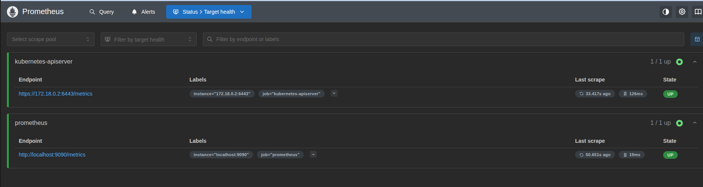
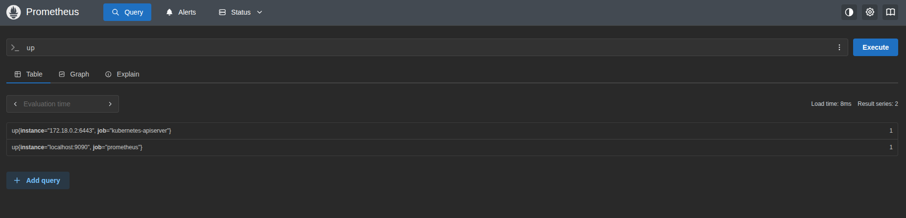
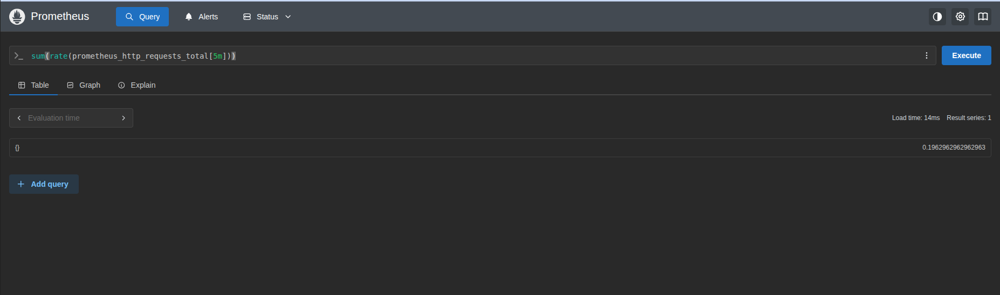
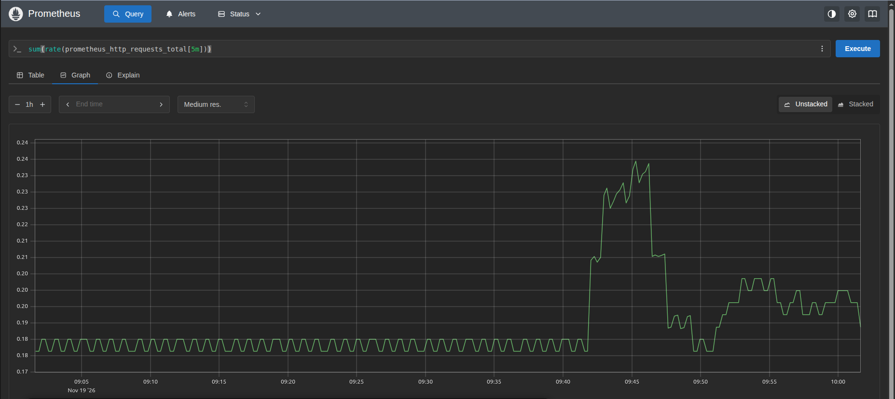
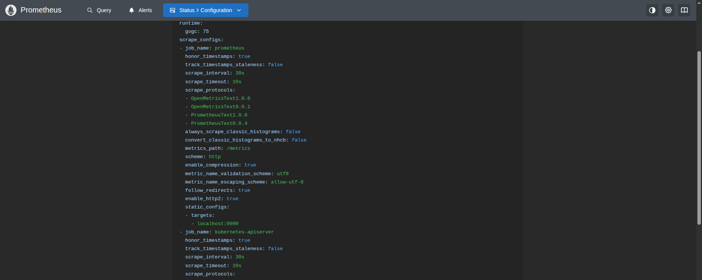
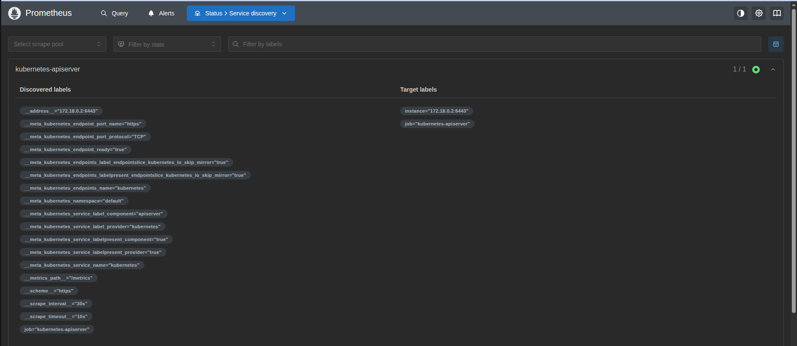
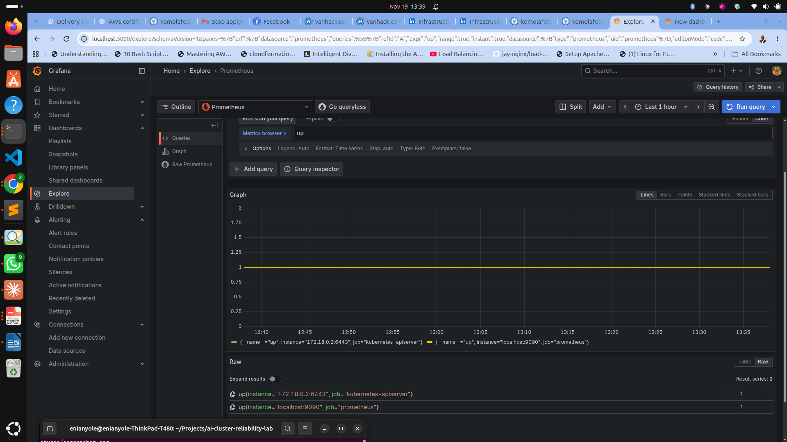
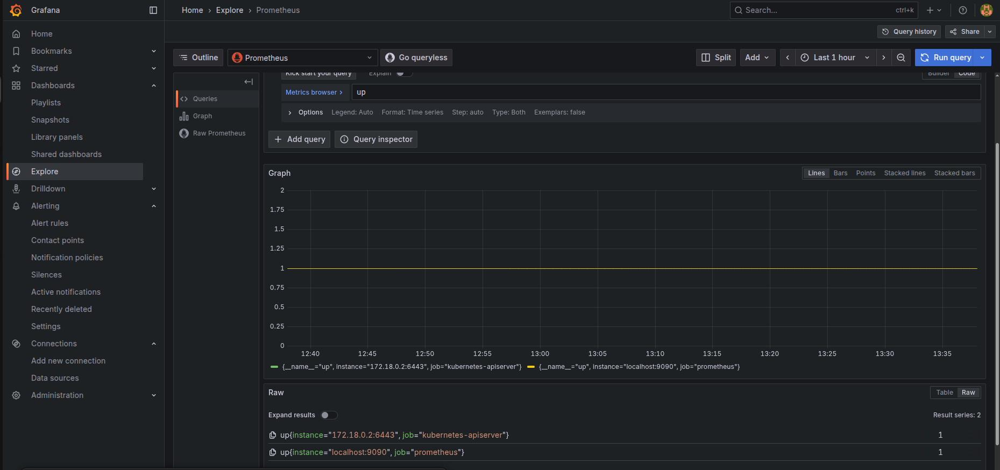

# LAB-010: Prometheus and Grafana Monitoring

**Phase:** 4 — Monitoring and Observability
**Status:** Monitoring infrastructure deployed and verified
**Environment:** Ubuntu Linux | kind Kubernetes | CPU-only
**Portfolio:** AI Infrastructure Reliability Lab

---

## 1. Overview

This lab demonstrates how to deploy, configure, and verify a Kubernetes monitoring stack using Prometheus and Grafana.

The objective is to develop practical Customer Reliability Engineering skills in infrastructure observability, monitoring troubleshooting, PromQL querying, and operational evidence collection.

The monitoring environment runs locally on a Lenovo ThinkPad T480 without requiring a GPU or cloud infrastructure.

### Learning Objectives

- Deploy Prometheus and Grafana in Kubernetes.
- Configure Kubernetes RBAC for metric discovery.
- Monitor Prometheus and Kubernetes API-server targets.
- Query infrastructure metrics using PromQL.
- Visualize metrics in Prometheus and Grafana.
- Verify monitoring service health.
- Capture evidence for troubleshooting documentation.
- Understand monitoring persistence and security limitations.

---

## 2. Lab Environment

| Component | Configuration |
|---|---|
| Operating system | Ubuntu Linux |
| Hardware | Lenovo ThinkPad T480 |
| Container runtime | Docker Engine |
| Kubernetes distribution | kind |
| Kubernetes version | v1.34.0 |
| Cluster name | `ai-reliability-lab` |
| Namespace | `monitoring` |
| Prometheus version | v3.5.0 |
| Grafana image | `grafana/grafana:12.1.0` |
| GPU | Not required |

### Architecture

```text
                    Ubuntu Host
                         |
                    Docker Engine
                         |
                 kind Kubernetes
                         |
                monitoring namespace
                         |
          +--------------+--------------+
          |                             |
     Prometheus                      Grafana
     Port 9090                       Port 3000
          |                             |
          |<------ PromQL queries ------|
          |
          +------ Prometheus metrics
          |
          +------ Kubernetes API-server metrics
```

Grafana queries Prometheus using the Kubernetes internal service address:

```text
http://prometheus.monitoring.svc.cluster.local:9090
```

---

## 3. Kubernetes Monitoring Resources

The following Kubernetes resources were deployed:

| Resource | Name | Purpose |
|---|---|---|
| Namespace | `monitoring` | Isolate monitoring components |
| ServiceAccount | `prometheus` | Kubernetes API access |
| ClusterRole | `lab-010-prometheus` | Read-only discovery permissions |
| ClusterRoleBinding | `lab-010-prometheus` | Bind permissions to service account |
| ConfigMap | `prometheus-config` | Prometheus scrape configuration |
| Deployment | `prometheus` | Run Prometheus |
| Service | `prometheus` | Internal access on port 9090 |
| ConfigMap | `grafana-datasource` | Provision Prometheus data source |
| Deployment | `grafana` | Run Grafana |
| Service | `grafana` | Internal access on port 3000 |
| Secret | `grafana-admin` | Grafana administrator password |

The Grafana administrator Secret is created directly in Kubernetes and is not stored in the Git repository.

### Kubernetes Manifest Files

All deployment manifests are stored in:

```text
monitoring/lab-010/
```

Files:

```text
namespace.yaml
prometheus-rbac.yaml
prometheus-config.yaml
prometheus-deployment.yaml
prometheus-service.yaml
grafana-datasource.yaml
grafana-deployment.yaml
grafana-service.yaml
```

---

## 4. Prometheus Deployment

Prometheus was deployed using Kubernetes YAML manifests.

The deployment uses a single replica with conservative resource limits suitable for a local CPU-only lab.

| Resource | Request | Limit |
|---|---|---|
| CPU | 100m | 500m |
| Memory | 128Mi | 512Mi |

Prometheus is configured with a 24-hour metric retention period.

Metrics are stored using an `emptyDir` volume, meaning data can be lost when the Prometheus pod is replaced.

### Prometheus Scrape Targets

Two scrape jobs are configured:

1. `prometheus` — Prometheus self-monitoring.
2. `kubernetes-apiserver` — Kubernetes API-server metrics.

### Screenshot 1 — Prometheus Target Health



**Finding:** Both monitoring targets were confirmed UP in the Prometheus interface.

---

## 5. PromQL Monitoring Queries

PromQL was used to investigate monitoring target health and live metric activity.

### Query 1 — Target Availability

```promql
up
```

The `up` metric indicates whether Prometheus successfully scraped a monitoring target.

- `1` indicates a successful scrape.
- `0` indicates a failed scrape.

### Screenshot 2 — PromQL Target Availability



### Query 2 — Prometheus HTTP Request Rate

```promql
sum(rate(prometheus_http_requests_total[5m]))
```

This query calculates the approximate per-second rate of HTTP requests handled by Prometheus over a five-minute window.

### Query 3 — Kubernetes API-server Request Rate

```promql
sum(rate(apiserver_request_total[5m]))
```

This query calculates the approximate per-second rate of Kubernetes API-server requests.

### Screenshot 3 — Live Metrics Graph



### Screenshot 4 — Additional Metrics Visualization



These screenshots document time-series metric exploration in Prometheus.

---

## 6. Prometheus Configuration Verification

Prometheus loads its scrape configuration from the `prometheus-config` ConfigMap.

The configuration defines scrape intervals and Kubernetes API-server discovery.

The API-server scrape uses the Kubernetes service account token and cluster CA certificate for authenticated HTTPS communication.

### Screenshot 5 — Prometheus Configuration



### Screenshot 6 — Kubernetes Service Discovery



**Technical observation:** The current configuration uses Kubernetes Endpoints discovery. Kubernetes v1.34 reports a deprecation warning for this discovery mechanism. Migrating to EndpointSlice discovery is a future improvement.

---

## 7. Grafana Deployment

Grafana was deployed in the same `monitoring` namespace as Prometheus.

The Grafana deployment uses:

- One replica.
- Kubernetes ConfigMap-based data source provisioning.
- A Kubernetes Secret for administrator credentials.
- HTTP readiness and liveness probes.
- A ClusterIP Service on port 3000.
- Temporary `emptyDir` storage.

### Grafana Resource Configuration

| Resource | Request | Limit |
|---|---|---|
| CPU | 100m | 500m |
| Memory | 128Mi | 384Mi |

### Prometheus Data Source

Grafana was configured to use Prometheus as its default data source.

```text
Name: Prometheus
Type: Prometheus
URL: http://prometheus.monitoring.svc.cluster.local:9090
```

The data source was provisioned automatically using the `grafana-datasource` ConfigMap.

Because it is provisioned through configuration, Grafana displays the data source as read-only in its web interface.

### Screenshot 7 — Grafana Prometheus Data Source



### Screenshot 8 — Grafana Metrics Graph



This screenshot documents metric visualization in Grafana.

---

## 8. Deployment Verification

The monitoring environment was verified using Kubernetes commands.

### Check Deployments

```bash
kubectl get deployments -n monitoring
```

Observed results:

```text
NAME         READY   UP-TO-DATE   AVAILABLE
grafana      1/1     1            1
prometheus   1/1     1            1
```

### Check Pods

```bash
kubectl get pods -n monitoring
```

Both pods were observed in the `Running` state with zero restarts.

### Check Services

```bash
kubectl get services -n monitoring
```

Observed services:

| Service | Type | Port |
|---|---|---|
| `grafana` | ClusterIP | 3000 |
| `prometheus` | ClusterIP | 9090 |

### Check Kubernetes Node Health

```bash
kubectl get nodes
```

Observed result:

```text
ai-reliability-lab-control-plane   Ready
```

These results confirmed that both monitoring deployments were available and the Kubernetes control-plane node remained healthy.

---

## 9. Accessing the Monitoring Interfaces

### Prometheus

```bash
kubectl -n monitoring port-forward service/prometheus 9090:9090
```

Open:

```text
http://localhost:9090
```

### Grafana

In another terminal:

```bash
kubectl -n monitoring port-forward service/grafana 3000:3000
```

Open:

```text
http://localhost:3000
```

Grafana administrator credentials are managed through a Kubernetes Secret and are not included in this repository.

---

## 10. Reliability Engineering Findings

### Finding 1 — Application Health Is Not the Same as Monitoring Health

A Prometheus pod can be running while individual scrape targets are failing.

Monitoring reliability therefore requires checking both Kubernetes workload status and Prometheus target health.

### Finding 2 — Service Discovery Must Be Verified

Prometheus relies on Kubernetes service discovery to identify monitoring endpoints.

Incorrect discovery rules, authentication, or RBAC permissions can prevent successful metric collection.

### Finding 3 — Grafana Depends on Prometheus Availability

Grafana provides visualization, but Prometheus performs the metric collection and query processing.

A healthy Grafana deployment does not guarantee that Prometheus is collecting usable data.

### Finding 4 — Resource Limits Matter

The monitoring stack was configured with conservative resource requests and limits to avoid unnecessary resource pressure on the local Kubernetes environment.

### Finding 5 — Monitoring Data Requires Persistence

The lab uses temporary storage.

In production environments, persistent volumes and suitable retention policies are necessary to preserve historical monitoring evidence.

### Finding 6 — Credentials Must Remain Private

Grafana administrator credentials were managed through a Kubernetes Secret rather than committed to Git.

---

## 11. Troubleshooting Commands

Inspect monitoring workloads:

```bash
kubectl get pods -n monitoring -o wide
```

Inspect Prometheus logs:

```bash
kubectl logs deployment/prometheus -n monitoring --tail=50
```

Inspect Grafana logs:

```bash
kubectl logs deployment/grafana -n monitoring --tail=50
```

Inspect deployment events:

```bash
kubectl describe deployment prometheus -n monitoring
kubectl describe deployment grafana -n monitoring
```

Check monitoring services:

```bash
kubectl get services -n monitoring
```

Check Kubernetes node health:

```bash
kubectl get nodes
```

These commands provide a starting point for investigating monitoring failures.

---

## 12. Limitations and Future Improvements

This lab uses a lightweight local monitoring environment rather than a production-grade monitoring architecture.

Future improvements include:

- Migrating Prometheus discovery from Endpoints to EndpointSlice.
- Adding persistent storage for Prometheus and Grafana.
- Exporting and provisioning reusable Grafana dashboards.
- Adding monitoring alerts and notification workflows.
- Monitoring additional Kubernetes workloads and node metrics.
- Automating health checks and evidence collection.

---

## 13. Customer Reliability Engineering Skills Demonstrated

This lab demonstrates practical experience with:

- Kubernetes monitoring deployment.
- Prometheus configuration and target discovery.
- Kubernetes RBAC.
- PromQL metric analysis.
- Grafana data source provisioning.
- Infrastructure health verification.
- Monitoring troubleshooting.
- Operational evidence collection.
- Secure credential handling.
- Technical documentation.

These skills are directly applicable to investigating infrastructure reliability issues in AI and high-performance computing environments.

---

## 14. Conclusion

LAB-010 established a functioning Prometheus and Grafana monitoring environment on a local Kubernetes cluster.

Prometheus successfully collected metrics from itself and the Kubernetes API server. Grafana was deployed and configured with Prometheus as its default data source.

The monitoring deployments and Kubernetes node were verified as healthy, and screenshots were captured to document the implementation.

The next lab, **LAB-011: Monitoring Alerts and Incident Detection**, will extend this environment with alerting rules, incident detection, and operational response workflows.
